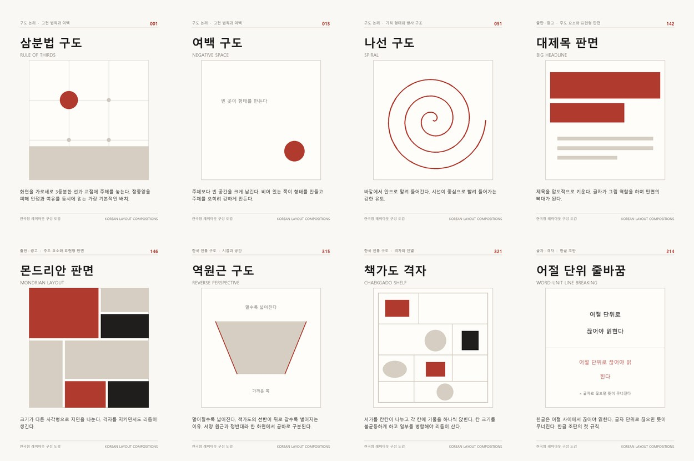
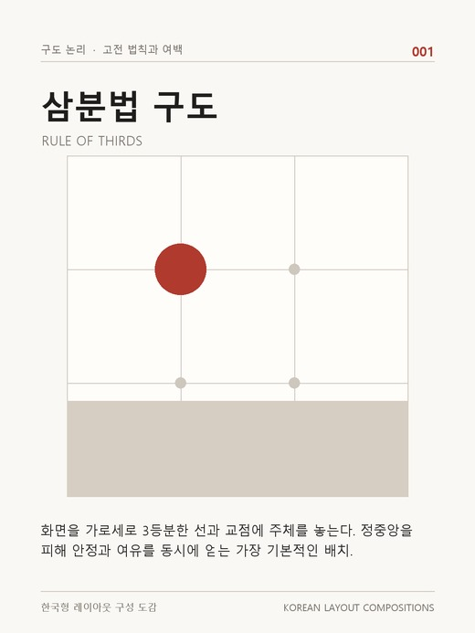
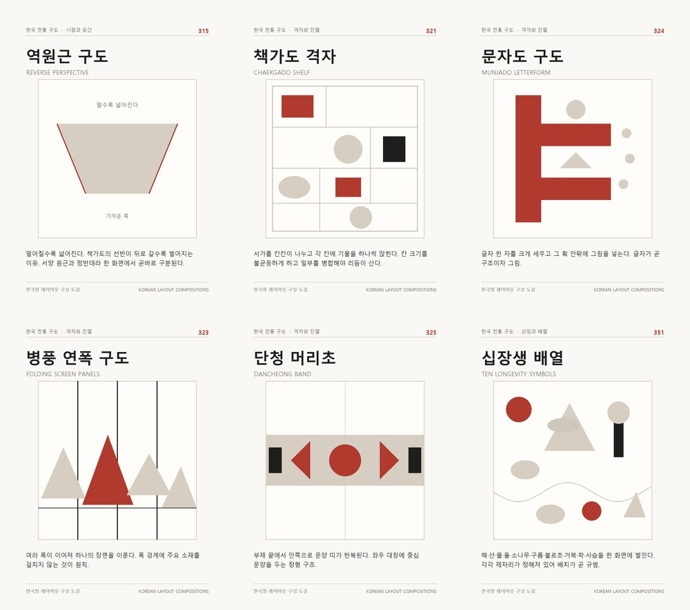
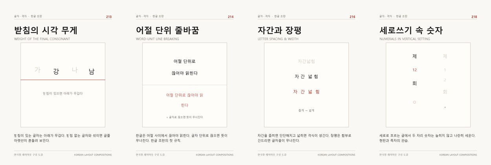
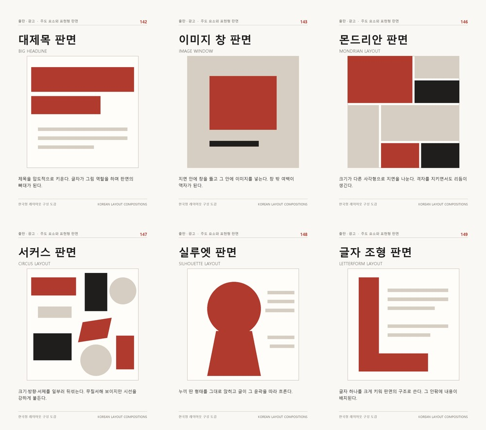

<div align="center">

# 한국형 레이아웃 구성 도감

**281종의 구성 원리를, 카드 한 장에 하나씩.**

구도 · 시각 원칙 · 출판 · 글자와 격자 · 영상 화면 · **한국 전통** · 발표 자료



[**📖 전체 목차 보기**](docs/README.md) · [🔍 검색용 목록 (catalog.csv)](catalog.csv) · [🇰🇷 한국 전통 구도](docs/07-korean-tradition.md)

[웹에서 카드 검색](https://worlyung.github.io/korean-layout-compositions/) · [축제 포스터와 공공 제안서 예시](docs/examples.md)

</div>

---

## 무엇인가요

포스터·제안서·행사물을 만들 때 **"이 지면을 어떻게 짤 것인가"**를 고르기 위한 도감입니다.

가져다 쓰는 템플릿 모음이 아니라 **원리 사전**입니다. 카드 한 장이 구성 원리 하나를 설명합니다.
그래서 이 도감은 "골라서 이름을 부르는" 방식으로 씁니다.

> 지면을 짜기 전에 해당 분류를 훑고 원리 하나를 고릅니다.
> 고른 원리의 **이름과 설명을 작업 지시나 생성 프롬프트에 그대로 적으면**,
> 즉흥으로 정하던 구성이 **이름 붙은 선택**이 됩니다.

### 카드 한 장은 이렇게 생겼습니다

<table>
<tr>
<td width="45%"></td>
<td valign="top">

**1086 × 1448 PNG**

| 위치 | 내용 |
|---|---|
| 상단 | 분류 · 소분류 · 일련번호 |
| 제목 | 한국어 이름 |
| 부제 | 영문 이름 |
| 가운데 | **원리를 보여주는 도해** |
| 하단 | 두세 줄 설명 |

바탕은 한지색, 글자는 먹, 강조는 주칠 붉은색을 씁니다.

</td>
</tr>
</table>

---

## 분류

| 분류 | 개수 | 무엇을 다루나 |
|---|---|---|
| [**01 구도 논리**](docs/01-composition-logic.md) | 86 | 삼분법·황금비부터 투시·심도까지. 화면 안에서 요소를 **어디에 놓을 것인가** |
| [**02 시각 원칙**](docs/02-visual-principles.md) | 45 | 균형·위계·대비·리듬·게슈탈트·읽기 패턴. 요소를 **어떻게 묶고 강조할 것인가** |
| [**03 출판 · 광고**](docs/03-editorial-advertising.md) | 37 | 단·펼침·재단, 표현형 판면, 모듈과 곁단, 출판 기능 지면 |
| [**04 글자 · 격자**](docs/04-type-grid.md) | 57 | 조직 체계·정렬·격자 + **한글 조판 12종** |
| [**06 영상 화면**](docs/06-film-frame.md) | 14 | 인물 수·시점·장면 배치. 콘티와 촬영 계획용 |
| [**07 한국 전통 구도**](docs/07-korean-tradition.md) | 26 | **오리지널.** 역원근·책가도·문자도·병풍·단청·십장생 |
| [**08 발표 자료**](docs/08-presentation.md) | 16 | 제안서와 발표 덱의 지면 유형 |
| | **281** | |

> 원본 도감에 있던 웹 UI 분류(79종)는 이 도감의 목적과 거리가 있어 제외했습니다.

---

## 이 도감에만 있는 것

### 🇰🇷 한국 전통 구도 26종

원본에는 중국 산수화의 삼원법·산점투시가 들어 있었습니다.
그것을 걷어내고 **한국 회화·공예·건축의 구도**로 새로 썼습니다.



**역원근 구도**가 첫 장입니다. 서양 원근은 멀어질수록 좁아지지만,
책가도의 선반은 **뒤로 갈수록 벌어집니다.** 정반대라서 한 화면에서 곧바로 구분됩니다.

| 절 | 항목 |
|---|---|
| 시점과 공간 | 역원근 · 다시점 · 부감 조감 · 평행 사선 · 유람 · 층단 |
| 격자와 진열 | **책가도 격자** · 기물 진열 · 병풍 연폭 · **문자도** · 단청 머리초 |
| 여백과 운필 | 여백 · 허실 · 소밀 · 주빈 · 개합 · 기승전결 · 장로 · 의정 · 일각 |
| 상징과 배열 | 십장생 · 사군자 · 까치호랑이 · 모란 화훼 · 산수 삼단 · 일수이석 |

전통 소재를 다룰 때 이 분류를 모르고 시작하면 **중국풍·일본풍으로 새거나 서양 원근으로 흘러갑니다.**

### ✍️ 한글 조판 12종

원본은 한자 조판 기준이었습니다. 한글은 **자소를 모아 쓰는 글자**라 문제가 다릅니다.



- **받침의 시각 무게** — 받침 있는 글자와 없는 글자가 섞이면 글줄 아랫선이 흔들립니다
- **어절 단위 줄바꿈** — 같은 문장을 어절 단위와 글자 단위로 나눠 읽는 흐름과 줄 길이를 비교합니다
- **줄바꿈 금칙** — 줄 끝의 여는 괄호와 줄 첫머리의 닫는 괄호를 피합니다. [W3C 한글 조판 요구사항 초안](https://www.w3.org/TR/klreq/#line-breaking-and-hyphenation)
- **세로쓰기 속 숫자** — 두 자리 숫자는 눕히지 않고 나란히 세웁니다. 현판과 족자의 관습
- 네모틀과 탈네모틀 · 글줄 사이 · 자간과 장평 · 한글 속 로마자 · 덧말 달기 · 문장부호 자리 · 제목의 띄어쓰기
- **다국어 병기 조판** — 같은 정보의 한국어와 외국어를 짝지어 놓고 언어별 위계를 정합니다

---

## 포스터를 만든다면

가장 자주 쓰게 될 분류는 **03 출판·광고**입니다.



`대제목 판면` · `이미지 창 판면` · `몬드리안 판면` · `서커스 판면` · `실루엣 판면` · `글자 조형 판면`

"글자를 크게 키운다"가 아니라 **"142 대제목 판면"**이라고 부르는 순간,
그 판면이 요구하는 것(글자가 그림 역할을 한다, 판면의 뼈대가 된다)이 함께 따라옵니다.

포스터에 날짜·장소·가격·신청 방법이 함께 들어간다면 **358 핵심 정보 묶음**으로 필수 정보를 한 영역에 모읍니다. 한영 병기에는 **359 다국어 병기 조판**을, 세로 포스터를 정사각 게시물과 가로 배너로 옮길 때는 **360 비율 전환 구도**를 적용합니다. [적용과 실패 예시](docs/examples.md#new-cards-in-practice)를 함께 보세요.

---

## 쓰는 법

### 1. 목차에서 훑기

[**docs/README.md**](docs/README.md)가 입구입니다. 분류를 누르면 4열 썸네일 표가 나오고,
썸네일을 누르면 원본 카드가 열립니다.

### 2. 검색해서 찾기

`catalog.csv`와 [`catalog.json`](catalog.json)에 281종의 이름·분류·설명이 들어 있습니다.

```bash
grep -i "여백\|대제목\|역원근" catalog.csv
```

| 열 | 내용 |
|---|---|
| `id` `name_ko` `name_en` | 번호와 이름 |
| `category` `subcategory` | 분류 |
| `image` `thumbnail` | 파일 경로 |
| `desc` | 설명 전문 |

<a id="web-search"></a>

### 브라우저에서 카드 검색

[공개 검색 페이지](https://worlyung.github.io/korean-layout-compositions/)를 열면 바로 검색할 수 있습니다. 맥에서 직접 열려면 저장소 폴더에서 아래 명령을 실행한 뒤 [로컬 검색 화면](http://127.0.0.1:8000/)을 엽니다.

```bash
python3 -m http.server 8000 --bind 127.0.0.1
```

카드 번호, 이름, 설명, 분류로 찾을 수 있습니다. `축제`, `공공 제안서`, `한영 병기`, `배너`는 실전 예시에 사용한 카드도 보여줍니다. 카드에서 **번호와 설명 복사**를 누르면 프롬프트에 바로 붙여넣을 수 있습니다.

### 3. AI 생성 프롬프트에 넣기

이 도감을 만든 계기가 이것입니다. 이미지 생성 모델에 구성을 지시할 때
**도감의 설명문을 그대로 옮겨 적습니다.** 요약하면 효과가 사라집니다.

```
315 역원근 구도 — 멀어질수록 넓어진다.
321 책가도 격자 — 칸을 불균등하게 나누고 일부를 병합해야 리듬이 산다.
```

이 두 줄을 프롬프트에 넣어 만든 포스터는, 서양 원근으로는 나올 수 없는 판면이 됩니다.

---

## 다시 만들기

카드는 **데이터에서 생성**됩니다. 설명을 고치거나 도해를 바꾸려면 JSON만 손보고 다시 돌립니다.

```
data/
  01-composition-logic.json    이름 · 영문명 · 설명
  diagrams-01.json             도해 스펙
build/
  render_card.py               Pillow 렌더러
  build_all.py                 카드 생성
  build_docs.py                썸네일 · 목차 · CSV 및 JSON 목록 생성
  verify_collection.py         카드 · 목록 · 문서 링크 검사
```

```bash
pip install pillow
python build/build_all.py     # 281장 재생성
python build/build_docs.py    # 목차와 썸네일 갱신
python build/verify_collection.py
```

맥에서는 Apple SD Gothic Neo, 윈도우에서는 맑은 고딕 또는 나눔고딕을 사용합니다. 리눅스에서는 Noto Sans CJK를 사용할 수 있습니다. 다른 한글 글꼴을 쓰려면 `LAYOUT_FONT`에 글꼴 파일 경로를, 필요하면 `LAYOUT_FONT_BOLD`에 굵은 글꼴 경로를 지정합니다. 기존 카드와 다시 만든 카드의 글자 모양은 운영체제와 글꼴에 따라 달라질 수 있습니다.

### 도해 스펙

도해는 좌표 기반 JSON입니다. 좌표는 도해 영역 기준 **0~1 정규 좌표**입니다.

```json
"1": [
  {"t": "grid", "x": 3, "y": 3},
  {"t": "dots", "at": [[0.333,0.333],[0.667,0.333]], "r": 0.016, "c": "line"},
  {"t": "circle", "x": 0.333, "y": 0.333, "r": 0.075, "c": "accent"}
]
```

**지원하는 요소**

`grid` `frame` `vline` `hline` `line` `rect` `circle` `ellipse` `poly`
`arc` `spiral` `wave` `zigzag` `dots` `label`

**색 이름**  `ink`(먹) `accent`(주칠) `fill`(엷은 채움) `line`(안내선) `sub`(보조 회색)

새 항목을 넣으려면 분류 JSON에 항목을 추가하고 같은 `id`로 도해 스펙을 쓰면 됩니다.

---

## 출처와 라이선스

분류 체계와 항목 구성은 **[350 Layout Compositions](https://github.com/nevertoday/350-layout-compositions)**
(nevertoday, CC BY 4.0)를 참고했습니다. 좋은 뼈대를 공개해 준 원저자에게 감사합니다.

이 저장소의 **텍스트·도해 스펙·렌더러 코드·생성된 이미지는 모두 새로 만든 것**이며,
**원본의 이미지는 한 장도 사용하지 않았습니다.**
07 한국 전통 구도와 04의 한글 조판 절은 원본에 없는 오리지널입니다.

**CC BY 4.0**으로 배포합니다. 출처를 밝히면 상업적 이용을 포함해 자유롭게 쓰고 고칠 수 있습니다.

---

<div align="center">
<sub>

**한국형 레이아웃 구성 도감** · 281종
[목차](docs/README.md) · [한국 전통 구도](docs/07-korean-tradition.md) · [한글 조판](docs/04-type-grid.md#hangul-typesetting)

</sub>
</div>
