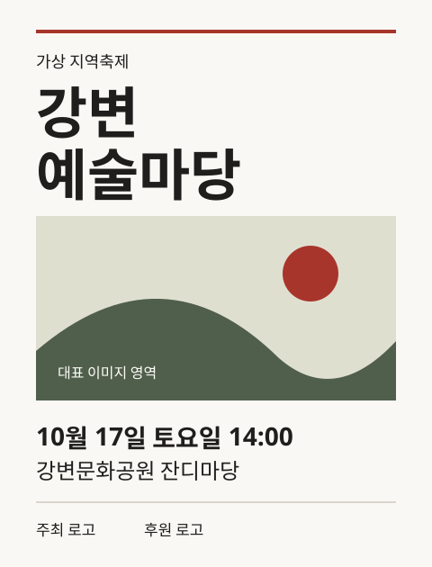
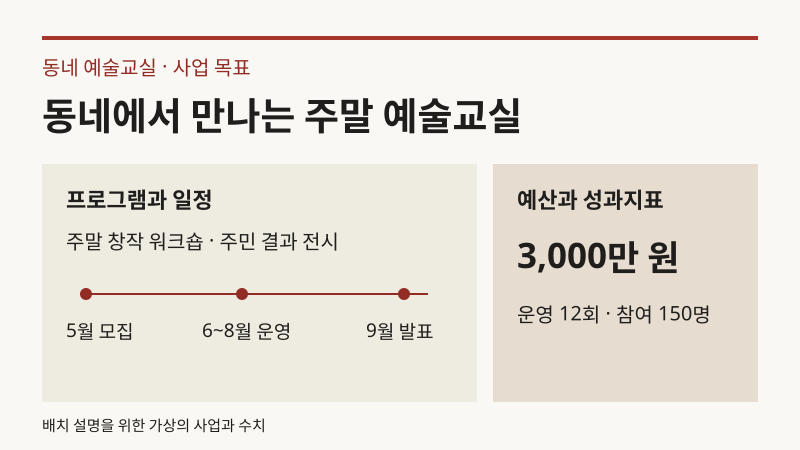

# 실전에서 카드 고르기

아래 두 지면은 배치 원리를 보여주기 위한 가상 사례입니다.

## 지역축제 포스터

| 사용한 카드 | 지면에 적용한 방식 |
| --- | --- |
| [095 시각 위계](02-visual-principles.md) | 행사명 → 일시·장소 → 주최·후원 순으로 글자 크기와 대비를 낮춥니다. |
| [142 대제목 판면](03-editorial-advertising.md) | 두 줄 행사명을 상단에 놓아 멀리서도 먼저 읽히게 합니다. |
| [143 이미지 창 판면](03-editorial-advertising.md) | 사진이나 대표 그림을 가운데 한 칸에 모아 일시·장소가 그림에 묻히지 않게 합니다. |

## 공공 제안서 한 장 요약

| 사용한 카드 | 지면에 적용한 방식 |
| --- | --- |
| [095 시각 위계](02-visual-principles.md) | 맨 위에서 사업 목표를 한 문장으로 읽히게 하고, 아래를 실행과 수치로 나눕니다. |
| [346 연표 지면](08-presentation.md) | 실행 영역에서 모집 → 운영 → 발표 순으로 시간 흐름을 보여줍니다. |
| [344 큰 숫자 지면](08-presentation.md) | 오른쪽에 총예산을 크게 놓고, 바로 아래에 운영 횟수와 참여 목표를 붙입니다. |

[← 전체 목차](README.md)
